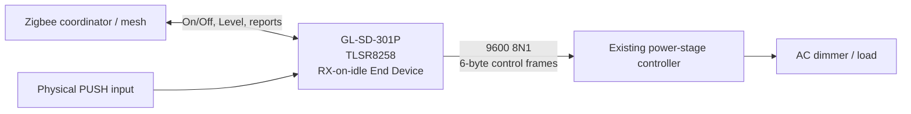

<div align="center">

# 💡 Gledopto firmware lab

### GL-SD-301P now runs as a quiet, always-awake Zigbee End Device.

**Independent, open firmware that turns the GLEDOPTO GL-SD-301P AC dimmer from a Zigbee router into a well-behaved leaf node, with full dimming and configurable power-restore behavior. Proven on real hardware, installed over the air.**


</div>

---

## 🎉 It works

On **2026-11-14** firmware **`GLSD-ED-009`** was installed **over the air** on a real, in-use GL-SD-301P in a living room. It joined back by itself, kept its End Device role, dims and switches normally, and the owner's verdict was: *"works as charm"*.

| | |
|---|---|
| 🟢 **Zigbee role** | Always-awake **End Device**: no routing, no children, no mesh traffic for other devices |
| 💡 **Control** | On/Off, Level (dimming), physical push button, attribute reporting, bindings |
| 🔌 **Power-restore** | **New:** choose what the lamp does when mains returns, with the brightness remembered |
| 📡 **Update path** | Over-the-air from Zigbee2MQTT: one transfer, about 25 minutes, no wires, no opening the case |
| 🔋 **Supply check** | First reading after boot **3272 mV**, so startup settings save normally |
| 🧪 **Build** | Pinned Telink toolchain, host and safety tests: all green on GitHub-hosted CI |

### 🔌 Power-restore behavior

Set `power_on_behavior` in Zigbee2MQTT (or the Home Assistant device page) to decide what happens after a power cut:

| Choice | After mains returns |
|---|---|
| **off** | stays off |
| **on** | turns on at the remembered brightness |
| **toggle** | the opposite of its state before the cut |
| **previous** | restores exactly the on/off state it had, at the remembered brightness |

Tip: if the dimmer's power is switched by a wall switch, use **on**. `previous` needs about three quiet seconds after the last change before the power is cut.

---

## 🚀 Flash it on your own GL-SD-301P

You need Zigbee2MQTT 2.x with zigbee-herdsman-converters 26.115 or newer, an MQTT client or the Z2M frontend, and the dimmer paired and online.

### ✅ Step 0: confirm it is the same hardware

Read these from the device (Z2M → *Dev console* → *Zigbee* → Read, or the *About* tab). All must match:

| Field | Expected |
|---|---|
| Model | GL-SD-301P (GLEDOPTO), endpoint 11 |
| Hardware version | `2` |
| Manufacturer code (OTA) | `0x124F` (4687) |
| OTA image type | `0x1416` (5142) |

Other revisions and other GLEDOPTO models are **not** covered. If anything differs, stop and open a research issue instead.

### 📥 Step 1: get the image

1. Open **Actions → "GL-SD-301P final no-spare readiness" → Run workflow** on the release commit.
2. Download the run artifact `glsd301p-ed-ota-<sha>`. It contains the `.ota`, the raw `.bin`, the build manifest and SHA-256/SHA-512 sums.
3. Check the hash of the `.ota` against the sums file. The image proven live is:

```text
SHA-256  d93ed2f8d091dbca2f607da2d418767050f9fb0236fca5f5cf3e4629a63e3fd9
```

Always use the hosted-CI build. It is the reference; a locally built image has no evidence behind it.

### 🧩 Step 2: install the converter

Copy [`devices/gl-sd-301p/zigbee2mqtt/glsd301p_ed.js`](devices/gl-sd-301p/zigbee2mqtt/glsd301p_ed.js) into your Zigbee2MQTT data directory and list it under `external_converters`. Restart Zigbee2MQTT. Do this **before** the update so the device keeps its exposes and gains `power_on_behavior` afterwards.

### 📡 Step 3: serve the image with a one-entry OTA index

Put the `.ota` in the Z2M data directory (for example `ota/`) and create an index file for it. This is the exact entry used on the reference unit (ED-008 → ED-009):

```json
[
  {
    "fileName": "glsd301p-ed-009-d93ed2f8.ota",
    "fileVersion": 2131361793,
    "fileSize": 144118,
    "url": "/config/zigbee2mqtt/ota/glsd301p-ed-009-d93ed2f8.ota",
    "imageType": 5142,
    "manufacturerCode": 4687,
    "sha512": "b37c5c523d00fba8b45968e15bdc8adbd5fdede64912ca08fe5e8324af6486272554302e3ebeea979b6935f0029bc548d801da3e7fb24f6a0cefb3066c4f76d8",
    "modelId": "GL-SD-301P-ED",
    "minFileVersion": 2131296257,
    "maxFileVersion": 2131296257
  }
]
```

Point the device at the index with the Zigbee2MQTT OTA override index setting (`zigbee_ota_override_index_location`) and use a 50-byte block size (`default_maximum_data_size: 50`), as on the reference unit. Adjust the `url` to your own data directory path.

> ⚠️ **Do not add `hardwareVersionMin` / `hardwareVersionMax`.** The Telink OTA client sends no hardware version in its query, so Zigbee2MQTT would never match the entry and always answer "no update available".

### ▶️ Step 4: update

In Zigbee2MQTT open the device → **OTA** tab → *Check for updates*. It must say an update is available. Then press **Update**. A normal transfer takes about 25 minutes at 50-byte blocks. Leave the lamp alone, don't restart Z2M and don't power-cycle the dimmer until it finishes. The device reboots and rejoins by itself.

### 🔎 Step 5: verify

- `swBuildId` reads **`GLSD-ED-009`** and OTA `currentFileVersion` is **2131361793** (`0x7F0A0001`).
- The device is still an **End Device** and `power_on_behavior` shows up.
- Read Basic attribute `0xFF11` (supply snapshot): readings must be **2200 mV or higher**. The reference unit reads about 3272 mV.
- Test On/Off, dimming and the push button.

The same flow updates future custom builds, using the current `fileVersion` as the min/max in the index.

### 🧰 Coming from the stock firmware?

The reference unit was converted from vendor firmware by a one-time wired SWire flash of the raw image. Converting stock to custom purely over the air has **not** been demonstrated yet, so treat that first conversion as an experimental step and keep a wired recovery option. Once the unit runs a custom build, all later updates are over the air as shown above.

### 🛟 If something looks wrong

- No update offered: check the index has no hardware-version fields, the sha512 matches, and the min/max equals the installed `fileVersion`.
- Transfer stalls: wait. Zigbee2MQTT retries by itself; it is slow, not broken.
- Rejoin never happens after a transfer: keep power on for a few minutes, then read [`devices/gl-sd-301p/SAFETY.md`](devices/gl-sd-301p/SAFETY.md) before touching anything else.

---

## What this project is about

A mains-powered Zigbee device is often shipped as a **Router**. When the router implementation is weak, children attach to it, routes traverse it, and one flaky light can disturb parts of the mesh that have nothing to do with it.

> Keep the device mains-powered and permanently listening, but make it a **Zigbee End Device / leaf** so it controls its own load without routing for the rest of the network.

```text
ZB_ED_ROLE=1   ZB_ROUTER_ROLE=0   RX_ON_WHEN_IDLE=1
PM_ENABLE=0    POWER_SOURCE=MAINS ENDPOINT=11
```

Not a router, not a sleepy battery device: **an always-awake mains-powered leaf node.** The product-specific hardware path is preserved. A Telink TLSR8258 talks to the existing power-stage controller over **9600 8N1 UART (PB1 TX / PA0 RX)**.



### Status at a glance

| Area | State |
|---|---|
| Hardware architecture | Established |
| Router role | Disabled (`libzb_ed.a`: no routing, no children) |
| On/Off, Level, push, reporting, power-restore | **Working in daily use** |
| Custom-to-custom OTA (ED-008 → ED-009) | **Proven live** |
| Build, host and safety tests | **PASS** on GitHub-hosted CI |
| Stock → custom by OTA | Not yet demonstrated |
| Vendor-firmware recovery by OTA | Planned, not yet exercised |
| Power-cycle startup test matrix | Not yet run on the bench |

Full evidence: [`devices/gl-sd-301p/STATUS.md`](devices/gl-sd-301p/STATUS.md), [issue #11](https://github.com/analienx/gledopto/issues/11) and [PR #12](https://github.com/analienx/gledopto/pull/12).

## Why this may be useful beyond one dimmer

The more interesting outcome is not one custom binary. It is a repeatable method for investigating other devices that are poor or unnecessary Zigbee routers.

A good future candidate is a device that:

1. is mains powered and therefore does not need sleepy operation;
2. uses a supported/researchable Zigbee MCU;
3. can keep its product-specific load controller intact;
4. has enough evidence to reconstruct its endpoint, clusters, GPIO and hardware interfaces safely;
5. would be more valuable to your network as an always-awake leaf than as a router.

That could eventually include additional GLEDOPTO dimmers, controllers, bulbs or related Telink-based hardware — **but support is model/revision specific, not assumed from branding alone**.

## What is actually in this repository

This repository is deliberately evidence-driven. It contains more than firmware source:

- [`devices/`](devices/) — per-device hardware and protocol ledgers
- [`evidence/`](evidence/) — captured, sanitized observations and analysis results
- [`tools/`](tools/) — firmware/static-analysis and validation tooling
- [`.github/workflows/`](.github/workflows/) — reproducible analysis/build gates
- [`AGENTS.md`](AGENTS.md) — automation/supervisor operating constraints
- [Issue #1](https://github.com/analienx/gledopto/issues/1) — the detailed GL-SD-301P engineering ledger
- [PR #12](https://github.com/analienx/gledopto/pull/12) — ED-009, the working End Device firmware (startup behavior, supply guard, OTA artifact publication)
- [Issue #11](https://github.com/analienx/gledopto/issues/11) — ED-009 review gate and live OTA result
- [PR #6](https://github.com/analienx/gledopto/pull/6) — earlier clean-room End Device candidate (historical)

The active implementation branch additionally separates vendor/reference evidence, the documented interoperability interface, and independently authored firmware so that one is not casually treated as the other.

## Want to investigate another device?

Please read [`CONTRIBUTING.md`](CONTRIBUTING.md) first. The most useful contribution is **evidence**: exact model/revision, Zigbee identity, endpoint descriptors, current role, software build/date code, logs, OTA metadata, photos or public documentation where legally shareable.

A request saying only “make this device an End Device” is usually not enough. A good evidence bundle can make a port dramatically more realistic.

## Safety and scope

This project deals with firmware for **mains-powered hardware**. Static analysis and successful CI do not establish electrical safety on an unknown hardware revision. Firmware must be matched to the exact target and validated through explicit gates.

No broad OTA publication, automatic mass update, or unrelated device mutation should be inferred from development artifacts in this repository.

Third-party/vendor firmware remains the property of its respective copyright holder. Reference material and independently authored implementation code must stay clearly separated, with provenance recorded where applicable.

---

<div align="center">

**Goal:** fewer unwanted Zigbee routers, while keeping the devices themselves fully useful.

If you own a GLEDOPTO/Telink device that looks like a good candidate, open a device-research issue with the evidence described in [`CONTRIBUTING.md`](CONTRIBUTING.md).

</div>
