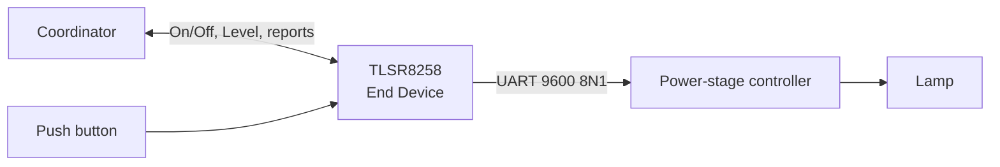

# Gledopto firmware lab

Custom Zigbee firmware for the GLEDOPTO GL-SD-301P AC dimmer. It runs the dimmer as an
always-on End Device instead of a router, so it controls its own lamp and doesn't carry
traffic for the rest of your mesh. You install it over the air from Zigbee2MQTT.

Current release: **`GLSD-ED-009`** (file version `0x7F0A0001`). It has been in daily use on a
real dimmer since 2026-11-14.

## Features

- Zigbee End Device that stays awake (RX on when idle). No routing and no child devices.
- On/Off, dimming, the physical push button, attribute reporting and bindings all work as before.
- `power_on_behavior` sets what happens when mains comes back: `off`, `on`, `toggle` or `previous`.
  The last brightness is remembered.
- OTA updates from Zigbee2MQTT. No wires, no opening the case.

## Requirements

- Zigbee2MQTT 2.x with zigbee-herdsman-converters 26.115 or newer
- A GL-SD-301P that is paired and online. Check these values before you start (Z2M →
  device → *About*, or read them in the *Dev console*):

| Field | Must be |
|---|---|
| Model / endpoint | GL-SD-301P (GLEDOPTO), endpoint 11 |
| Hardware version | `2` |
| OTA manufacturer code | `0x124F` (4687) |
| OTA image type | `0x1416` (5142) |

If anything differs, stop. Other revisions and other GLEDOPTO models aren't supported.

## Install

The steps are the same whether the dimmer runs the stock firmware or an earlier build from
this repo. Only the version in the OTA index changes.

### 1. Get the image

Run **Actions → "GL-SD-301P final no-spare readiness" → Run workflow** and download the
`glsd301p-ed-ota-<sha>` artifact. Check the `.ota` against the sums file. The released ED-009
image is:

```text
SHA-256  d93ed2f8d091dbca2f607da2d418767050f9fb0236fca5f5cf3e4629a63e3fd9
```

Use the CI build, not a local one.

### 2. Add the converter

Copy [`devices/gl-sd-301p/zigbee2mqtt/glsd301p_ed.js`](devices/gl-sd-301p/zigbee2mqtt/glsd301p_ed.js)
into the Zigbee2MQTT data directory, add it under `external_converters` and restart Z2M.
Do this before you update.

### 3. Create a local OTA index

Put the `.ota` in the Z2M data directory (for example `ota/`) and create an index with one entry:

```json
[
  {
    "fileName": "glsd301p-ed-009-d93ed2f8.ota",
    "fileVersion": 2131361793,
    "fileSize": 144118,
    "url": "/config/zigbee2mqtt/ota/glsd301p-ed-009-d93ed2f8.ota",
    "imageType": 5142,
    "manufacturerCode": 4687,
    "sha512": "b37c5c523d00fba8b45968e15bdc8adbd5fdede64912ca08fe5e8324af6486272554302e3ebeea979b6935f0029bc548d801da3e7fb24f6a0cefb3066c4f76d8",
    "modelId": "GL-SD-301P-ED",
    "minFileVersion": 2131296257,
    "maxFileVersion": 2131296257
  }
]
```

Set `minFileVersion` and `maxFileVersion` to the version the dimmer runs now (OTA attribute
`currentFileVersion`):

| Dimmer runs | min/max |
|---|---|
| Stock firmware (`20651203`) | `637612033` (`0x26013001`) |
| `GLSD-ED-008` | `2131296257` (`0x7F090001`) |

Fix the `url` to match your data directory. Point Z2M at the file with
`zigbee_ota_override_index_location` and set `default_maximum_data_size: 50`.

Leave out `hardwareVersionMin`/`hardwareVersionMax`. The dimmer doesn't send a hardware
version in its OTA query, so an entry that has them never matches.

### 4. Update

Open the device in Z2M → **OTA** → *Check for updates*. When it reports an update, press
**Update**. The transfer takes about 25 minutes. Don't restart Z2M or cut power to the dimmer
while it runs. When it's done, the dimmer reboots and rejoins by itself.

### 5. Check

- `swBuildId` is `GLSD-ED-009` and `currentFileVersion` is `2131361793`.
- The device shows as an End Device and has `power_on_behavior`.
- Basic attribute `0xFF11` (supply reading) is 2200 mV or more. The reference unit reads about 3272 mV.
- On/Off, dimming and the push button work.

### Updating from the stock firmware

The stock firmware ships with the same Telink OTA client and uses the same manufacturer code
and image type, and ED-009 has a higher file version. The stock firmware therefore accepts
the image through the normal OTA steps above. You don't need a wired flash.

The reference unit was first flashed over SWire only because it had to be recovered from an
earlier test build. Nobody has done a stock-to-ED-009 OTA on real hardware yet. If you try
it, please report the result in an issue. If the dimmer can't use the stock network settings
after the update, it comes back as a new device: turn on permit join and let it pair.

## Troubleshooting

- **No update offered:** remove any hardware-version fields, check that `sha512` matches the
  file, and check that min/max equal the installed `currentFileVersion`.
- **Transfer is slow:** about 25 minutes is normal. Z2M retries failed blocks by itself.
- **Device doesn't come back:** leave it powered for a few minutes. If it still isn't back,
  turn on permit join.

Recovery notes are in [`devices/gl-sd-301p/SAFETY.md`](devices/gl-sd-301p/SAFETY.md).

## How it works

The dimmer has a Telink TLSR8258 Zigbee chip that drives a separate power-stage controller
over UART (9600 8N1, PB1 TX / PA0 RX). This firmware replaces only the Zigbee side and keeps
that link, so the dimming hardware behaves the same.

```text
ZB_ED_ROLE=1   ZB_ROUTER_ROLE=0   RX_ON_WHEN_IDLE=1
PM_ENABLE=0    POWER_SOURCE=MAINS ENDPOINT=11
```



## Building

| Path | Contents |
|---|---|
| [`src/`](src/) | Device logic: control, startup/power-restore, UART link, push input, rejoin |
| [`firmware/glsd301p-ed/`](firmware/glsd301p-ed/) | Telink target config, pin map, version |
| [`tools/`](tools/) | Build script, SDK patches, OTA wrapper, checks, bench tools |
| [`tests/`](tests/) | Host tests |
| [`devices/gl-sd-301p/`](devices/gl-sd-301p/) | Device notes, Z2M converter, status |

The easiest way is GitHub Actions: fork the repo, enable Actions and run the
[readiness workflow](.github/workflows/glsd301p-final-readiness.yml). It pins the
[Telink Zigbee SDK](https://github.com/telink-semi/telink_zigbee_sdk) at `V3.7.2.0`
(`d5bc2f7b`) and the TC32 toolchain `tc32_gcc_v2.0`, runs the tests and produces the `.ota`.

To build locally with the same SDK and toolchain:

```bash
export TELINK_SDK_ROOT=/path/to/telink-sdk/tl_zigbee_sdk
export TC32_CC=/path/to/tc32/bin/tc32-elf-gcc
bash tools/build_glsd301p_ed_tc32.sh   # output in $OUT_DIR (default /tmp/glsd301p-ed-tc32)
```

Compare a local build against the CI hashes before you flash it.

## Other devices

The same approach could work for other mains-powered GLEDOPTO/Telink devices, but each model
and revision has to be checked separately. If you have one in mind, read
[`CONTRIBUTING.md`](CONTRIBUTING.md) and open an issue with the device details (model,
revision, Zigbee identity, endpoints, firmware version, OTA info, photos).

## Notes

- Engineering history: [`devices/gl-sd-301p/STATUS.md`](devices/gl-sd-301p/STATUS.md),
  [issue #1](https://github.com/analienx/gledopto/issues/1), [issue #11](https://github.com/analienx/gledopto/issues/11).
- Vendor firmware belongs to its copyright holder. It is kept apart from the code written
  here (see [`CLEAN_ROOM.md`](CLEAN_ROOM.md)).
