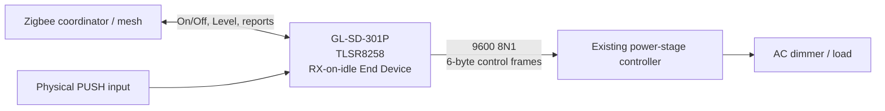

<div align="center">

# Gledopto firmware lab

### Make selected GLEDOPTO Zigbee devices better citizens of your mesh.

**Clean-room firmware, hardware interoperability research, and tooling for turning compatible mains-powered GLEDOPTO/Telink devices from Zigbee routers into always-awake End Devices (leaf nodes) — without giving up normal lighting control.**


</div>

---

## Why this project exists

A mains-powered Zigbee device is often shipped as a **Router**. That is useful when the router implementation is excellent. When it is not, the device can become an undesirable part of the mesh: children may attach to it, routes may traverse it, and failures can affect devices that otherwise have nothing to do with the light or dimmer.

This project explores a different option for compatible hardware:

> Keep the device mains-powered and permanently listening, but make it a **Zigbee End Device / leaf** so it controls its own load without routing traffic for the rest of the network.

This is **not** a generic firmware patch that can safely be applied to every GLEDOPTO product. Each hardware family must be understood and validated independently.

## First target: GL-SD-301P

The first implementation targets the **GLEDOPTO GL-SD-301P Zigbee AC dimmer**.

The independently written candidate firmware is designed as:

```text
ZB_ED_ROLE=1
ZB_ROUTER_ROLE=0
RX_ON_WHEN_IDLE=1
PM_ENABLE=0
POWER_SOURCE=MAINS
ENDPOINT=11
```

In other words: **not a router, not a sleepy battery device, but an always-awake mains-powered leaf node.**

The firmware also preserves the product-specific hardware path rather than replacing the mains dimmer logic. Research established a Telink TLSR8258-family Zigbee MCU talking to the existing power-stage controller over **9600 8N1 UART (PB1 TX / PA0 RX)**.



### What the candidate preserves

- Zigbee On/Off and Level Control
- physical PUSH control
- attribute reporting
- direct binding behavior
- reliable electrical OFF semantics
- startup synchronization
- the original secondary power-stage architecture
- OTA/recovery plumbing needed for controlled validation

### Current status: working End Device firmware (ED-009)

**`GLSD-ED-009` (fileVersion `0x7F0A0001`) runs on a real GL-SD-301P as an always-awake End Device and works in daily use.** It was installed over the air on 2026-11-14 from the previous custom build ED-008, and the owner reports that it "works as charm". Other GL-SD-301P owners can use it as a working End Device firmware for this dimmer, within the limits below.

| Area | State |
|---|---|
| Hardware architecture | **Established** |
| Zigbee role on hardware | **RX-on-idle End Device, verified live** |
| Router role | **Disabled** (`libzb_ed.a`, no routing, no children) |
| On/Off, Level, physical PUSH, reporting | **Working in daily use** |
| Configurable power-on behavior | **New in ED-009**: off / on / toggle / previous, with the brightness remembered |
| Custom-to-custom OTA (ED-008 → ED-009) | **Proven live**: one transfer, about 25 min at 50-byte blocks, device rejoined by itself |
| PB3 supply reading after boot | **3272 mV** (Basic `0xFF11`), so startup settings save normally |
| Pinned Telink SDK/toolchain build, host and safety tests | **PASS** on hosted CI |
| Stock → custom conversion by OTA | **Not proven**: the first install on the reference unit was a wired SWire flash |
| Vendor-firmware recovery by OTA | Planned (downgrade topic, same-model vendor image), **not yet exercised** |

#### Using it on your own GL-SD-301P

1. **Check that you have the same hardware.** Use this only on a GL-SD-301P that reports `hwVersion 2`, manufacturer code `0x124F` (4687) and image type `0x1416` (5142), with the TLSR8258 module described in [`devices/gl-sd-301p/`](devices/gl-sd-301p/). Other revisions or GLEDOPTO models are **not** supported.
2. **Get the exact CI-built image.** Run the *GL-SD-301P final no-spare readiness* workflow manually (`workflow_dispatch`) on the release commit. It publishes the `.ota`, the raw `.bin`, the build manifest and SHA-256/SHA-512 sums as a run artifact. The live-proven ED-009 OTA has SHA-256 `d93ed2f8d091dbca2f607da2d418767050f9fb0236fca5f5cf3e4629a63e3fd9`. Don't flash a local build; the hosted build is the reference.
3. **Install the Zigbee2MQTT external converter** [`devices/gl-sd-301p/zigbee2mqtt/glsd301p_ed.js`](devices/gl-sd-301p/zigbee2mqtt/glsd301p_ed.js) first. It has been checked against zigbee-herdsman-converters 26.115.1 (live), 26.125.0 and the latest release (CI).
4. **First install from stock firmware:** the reference unit was converted by a wired SWire flash of the raw image. Converting stock firmware over the air is untested; treat it as experimental and keep a wired recovery option.
5. **Updating an already-converted unit:** use a one-entry Zigbee2MQTT OTA index that names the image's `sha512`, `modelId` `GL-SD-301P-ED` and your current `fileVersion`. **Do not set `hardwareVersionMin`/`Max`**: the Telink OTA client sends no hardware version in its query, so Zigbee2MQTT would never match the entry. Send the targeted `bridge/request/device/ota_update/update` request for your device only.
6. **After the update,** confirm a fresh `swBuildId` and OTA `currentFileVersion` read from the device. Then read Basic `0xFF11` and check that the supply readings are at least 2200 mV.

A removed unit re-joins on the next permit-join, like most Zigbee devices. Add its IEEE address to the Zigbee2MQTT `blocklist` to keep it out. Safety rules and behavior details: [`devices/gl-sd-301p/SAFETY.md`](devices/gl-sd-301p/SAFETY.md).

This is independent firmware for one hardware revision, offered as-is. A green CI build alone is not a recommendation to flash a different unit.

## Why this may be useful beyond one dimmer

The more interesting outcome is not one custom binary. It is a repeatable method for investigating other devices that are poor or unnecessary Zigbee routers.

A good future candidate is a device that:

1. is mains powered and therefore does not need sleepy operation;
2. uses a supported/researchable Zigbee MCU;
3. can keep its product-specific load controller intact;
4. has enough evidence to reconstruct its endpoint, clusters, GPIO and hardware interfaces safely;
5. would be more valuable to your network as an always-awake leaf than as a router.

That could eventually include additional GLEDOPTO dimmers, controllers, bulbs or related Telink-based hardware — **but support is model/revision specific, not assumed from branding alone**.

## What is actually in this repository

This repository is deliberately evidence-driven. It contains more than firmware source:

- [`devices/`](devices/) — per-device hardware and protocol ledgers
- [`evidence/`](evidence/) — captured, sanitized observations and analysis results
- [`tools/`](tools/) — firmware/static-analysis and validation tooling
- [`.github/workflows/`](.github/workflows/) — reproducible analysis/build gates
- [`AGENTS.md`](AGENTS.md) — automation/supervisor operating constraints
- [Issue #1](https://github.com/analienx/gledopto/issues/1) — the detailed GL-SD-301P engineering ledger
- [PR #12](https://github.com/analienx/gledopto/pull/12) — ED-009, the working End Device firmware (startup behavior, supply guard, OTA artifact publication)
- [Issue #11](https://github.com/analienx/gledopto/issues/11) — ED-009 review gate and live OTA result
- [PR #6](https://github.com/analienx/gledopto/pull/6) — earlier clean-room End Device candidate (historical)

The active implementation branch additionally separates vendor/reference evidence, the documented interoperability interface, and independently authored firmware so that one is not casually treated as the other.

## Want to investigate another device?

Please read [`CONTRIBUTING.md`](CONTRIBUTING.md) first. The most useful contribution is **evidence**: exact model/revision, Zigbee identity, endpoint descriptors, current role, software build/date code, logs, OTA metadata, photos or public documentation where legally shareable.

A request saying only “make this device an End Device” is usually not enough. A good evidence bundle can make a port dramatically more realistic.

## Safety and scope

This project deals with firmware for **mains-powered hardware**. Static analysis and successful CI do not establish electrical safety on an unknown hardware revision. Firmware must be matched to the exact target and validated through explicit gates.

No broad OTA publication, automatic mass update, or unrelated device mutation should be inferred from development artifacts in this repository.

Third-party/vendor firmware remains the property of its respective copyright holder. Reference material and independently authored implementation code must stay clearly separated, with provenance recorded where applicable.

---

<div align="center">

**Goal:** fewer unwanted Zigbee routers, while keeping the devices themselves fully useful.

If you own a GLEDOPTO/Telink device that looks like a good candidate, open a device-research issue with the evidence described in [`CONTRIBUTING.md`](CONTRIBUTING.md).

</div>
